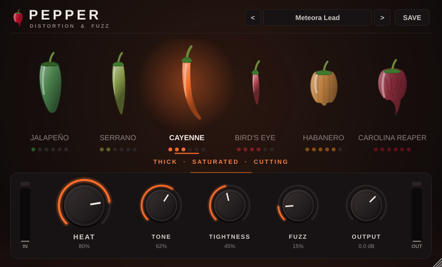

# PEPPER — guitar distortion & fuzz

A focused distortion / fuzz plug-in (VST3, AU, AAX · macOS · 64-bit) voiced for tight, aggressive,
modern rock and metal guitar — the punchy mid-forward crunch of early-2000s nu-metal and the dense,
fuzzy walls of 2010s metalcore.

Pick a pepper, turn up the Heat.



## The peppers

Each pepper is its own circuit — its own clipping topology, filtering and voicing — not just more gain.

| | Pepper | Character | Under the hood |
|---|---|---|---|
| 🟢 | **Jalapeño** | Warm, crunchy overdrive | Mid-push overdrive that only clips above ~720 Hz, summed with clean, into a gently biased amp stage |
| 🟢 | **Serrano** | Gritty, punchy rock crunch | Biased triode → cathode-style high-pass → hard-knee sine clipper, upper-mid bite |
| 🟠 | **Cayenne** | Classic thick, saturated distortion | Op-amp gain stage whose bandwidth shrinks as gain rises (thicker the hotter it gets), slew-limited, into hard diodes |
| 🔴 | **Bird's Eye** | Tight high gain, sharp attack, defined chugs | Boost-style high-passed front end into a three-stage cascade, extra pick-attack emphasis |
| 🟠 | **Habanero** | Modern metal: dense, biting, compressed | Four-stage cascade with power-supply "sag" compression on the last stage |
| 🔴 | **Carolina Reaper** | Extreme, blown-out, chaotic fuzz | Slammed sine clipper → "Fracture" expansion → wavefold blend → starved, biased output stage |

## Controls

| Control | What it does |
|---|---|
| **Pepper** | Distortion character (click a pepper, scroll over them, or use ← →) |
| **Heat** | Amount of distortion. Output level is auto-matched, so Heat changes the *sound*, not just the volume |
| **Tone** | Darker ↔ brighter (warmth tilt, presence and top-end roll-off together) |
| **Tightness** | Up: less bass into the clipper for tight palm mutes, with clean low end added back around it so it stays thick. Down: looser, bigger, saggier bottom |
| **Fuzz** | Blends in a parallel fuzz voice (two-stage clip, octave-up ring, scooped mids). On the Reaper it also wavefolds |
| **Output** | Final volume, −24 to +12 dB |

IN / OUT meters show peak level with a clip light. Double-click any knob to reset it.
PEPPER is a pedal-style distortion: for a full amp sound, put an amp or cabinet IR after it.

### Factory presets

**Hybrid Crunch** (Bird's Eye) · **Meteora Lead** (Cayenne) · **Modern Metal** (Habanero) ·
**Sempiternal Fuzz** (Habanero + fuzz) · **Carolina Chaos** (Carolina Reaper)

Save your own with **SAVE** — they go in `~/Documents/PEPPER/Presets` as small `.pepper` files you can share
with the band. Your DAW's own preset system works too.

## Installing

1. Download **[PEPPER-macOS.zip](https://github.com/finleypower123-cell/Red-Hot/raw/builds/PEPPER-macOS.zip)**
   (always the latest build of `main`, no GitHub login needed), or grab it from **Releases** if there is one.
2. Unzip it and double-click **Install PEPPER.pkg**. The first time, macOS will say it's from an unidentified
   developer: right-click it → **Open**, or allow it under System Settings → Privacy & Security → **Open Anyway**.
   It installs the AAX into `/Library/Application Support/Avid/Audio/Plug-Ins` (Pro Tools) and the VST3 / AU into
   `/Library/Audio/Plug-Ins`. (Prefer Terminal? **Install PEPPER.command** does the same into your user folders.)
3. Restart your DAW and look for **PEPPER** by **Red Hot** under Distortion / Harmonic.

### Pro Tools

Pro Tools only loads **AAX** plug-ins, and the regular version of Pro Tools only loads AAX plug-ins that have been
**digitally signed with PACE/iLok**. The build here produces an AAX, but it is unsigned. Your options:

| Option | Cost | What to do |
|---|---|---|
| **Sign it** (best) | Free for developers | Join the Avid developer programme and request PACE Eden signing tools (free for AAX developers, needs an iLok account). Then run `wraptool sign --account <you> --wcguid <your-guid> --signid "<your cert>" --in PEPPER.aaxplugin --out PEPPER.aaxplugin` and install. Works in every Pro Tools. |
| **Pro Tools Developer** | Free | Avid's developer build of Pro Tools loads unsigned AAX plug-ins as they are. Good for testing. |
| **Use a wrapper** | Paid | A wrapper plug-in such as Blue Cat's PatchWork or DDMF Metaplugin loads the **VST3/AU** version inside Pro Tools straight away. |

Every other Mac DAW (Logic, Ableton Live, Reaper, Cubase, Studio One, GarageBand) loads the AU/VST3 directly.

## Building from source

Needs CMake ≥ 3.22 and Xcode (or the command-line tools). JUCE is downloaded automatically.

```bash
cmake -S . -B build -G Xcode                 # or -G Ninja -DCMAKE_BUILD_TYPE=Release
cmake --build build --config Release
```

Plug-ins land in `build/Pepper_artefacts/Release/{VST3,AU,AAX}`. Add `-DPEPPER_COPY_AFTER_BUILD=ON` to install them
automatically, `-DPEPPER_BUILD_AAX=OFF` to skip AAX, `-DJUCE_PATH=/path/to/JUCE` to use your own JUCE checkout and
`-DPEPPER_BUILD_TESTS=ON` to build the test programs. Every push to `main` builds and validates on GitHub
(auval for the AU, pluginval for the VST3) and uploads the zip.

## Technical notes

- **DSP**: all state preallocated; nothing allocates, locks or does I/O on the audio thread. Processing runs in
  32-sample chunks so filters follow smoothed parameters without zipper noise; pepper changes crossfade over 30 ms.
- **Anti-aliasing**: the clipping stages run oversampled at ~350–400 kHz whatever the session rate (8× at 44.1/48k,
  4× at 88.2/96k, 2× at 176.4/192k) with low-latency IIR filters, and every high-gain stage is slew-limited like a real
  op-amp. Latency is 6 samples (0.13 ms) and is reported to the host; bypass is latency-matched.
- **Gain staging**: auto-levelled to about −16 dBFS RMS for a DI guitar peaking around −9 dBFS, at any Heat and
  any pepper. A gentle hidden expander under −62 dBFS keeps high-gain hiss from blooming between notes.
- **Formats & layouts**: mono → mono, mono → stereo, stereo → stereo. Universal binary (Apple Silicon + Intel),
  macOS 10.13+.
- **Tests** (`tests/`): level/tonal balance per pepper, aliasing measurements, a random-automation torture test,
  click checks on pepper changes, CPU, sample-rate independence, presets and state restore.

## Credits & licences

Several clipping curves are adapted from the [Airwindows](https://github.com/airwindows/airwindows) plug-ins by
Chris Johnson (MIT licence — see `THIRD_PARTY_NOTICES.md`): the Density-style sine clipper, the Fracture expansion
stage and the GrindAmp idea of re-injecting clean lows around the clipper.

Built with [JUCE](https://juce.com) (AGPLv3 / commercial). Fine for your own use; if you ever sell or distribute
PEPPER closed-source you'll need a JUCE licence (there is a free tier for small developers), and distributing an
AAX needs the Avid developer agreement.
